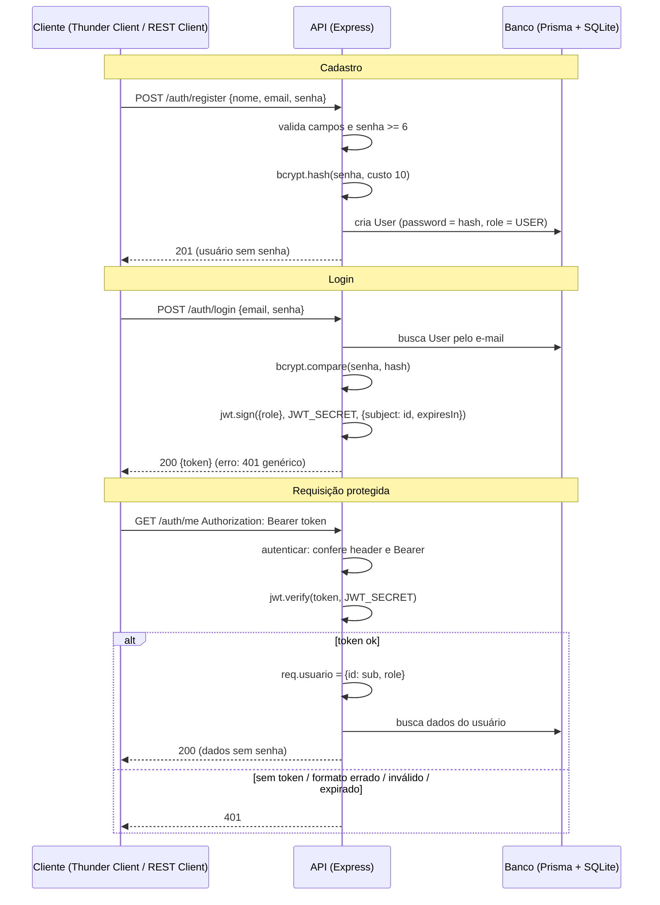

# API Receitas — Projeto API Segura

**Grupo:** Davi Alexandre, Guilherme Alves, Pedro H. Hahnl · 3º AI · ETECAMP
**Nome do projeto:** PPPitacos Culinários

## 1. Sobre o projeto

O **PPPitacos Culinários** é uma API REST de receitas. Qualquer pessoa pode ler as receitas; para publicar é preciso se cadastrar e fazer login. Cada receita pertence ao seu autor (o *dono*): só ele edita ou apaga a própria receita. Um ADMIN modera o sistema (edita/remove qualquer receita, lista usuários e muda perfis).
Tecnologias: Node.js, Express 5, Prisma ORM 7, SQLite, `jsonwebtoken`, `bcryptjs`.

## 2. Como rodar

Pré-requisito: Node.js 20 ou superior.

```bash
npm install
copy .env.example .env        # Linux/Mac: cp .env.example .env
npx prisma migrate dev --name init
npx prisma generate
npx prisma db seed
npm run dev
```

A API sobe em `http://localhost:3000`. Para rodar os testes automáticos (com o servidor ligado em outro terminal): `npm run testar`.
Para voltar o banco ao estado inicial: `npx prisma migrate reset` (ele recria o banco e roda o seed; depois rode `npx prisma generate` se pedir).

**Usuários de teste** (senha de todos: `Senha123`):

| E-mail | Perfil | id |
|---|---|---|
| admin@pppitacos.com | ADMIN | 1 |
| davi@pppitacos.com | USER | 2 |
| guilherme@pppitacos.com | USER | 3 |

Receitas do seed: 1 e 2 (Davi), 3 e 4 (Guilherme), 5 (Admin).

**Estrutura de pastas**

```
prisma/        schema.prisma, migrations e seed.js
src/
  lib/          prisma.js (client + adapter) e jwt.js (gerar/verificar token)
  middlewares/  autenticar.js, autorizar.js, limitarLogin.js, erros.js
  controllers/  authController, receitaController, userController
  routes/       authRoutes, receitaRoutes, userRoutes
  app.js, server.js
requests.http   testes T1–T10 (extensão REST Client do VS Code)
scripts/testar.js  testes automáticos
```

## 3. Mapa de rotas

| Método | Rota | Acesso | Proteção |
|---|---|---|---|
| GET | / | Pública | — |
| POST | /auth/register | Pública | validações; senha em hash bcrypt; nasce USER |
| POST | /auth/login | Pública | limite de 10 falhas / 15 min (429); erro genérico |
| GET | /auth/me | Logado | `autenticar` |
| PATCH | /auth/senha | Logado | `autenticar` + confere a senha atual (extra) |
| GET | /receitas | Pública | — |
| GET | /receitas/:id | Pública | 404 se não existir |
| GET | /receitas/minhas | Logado | `autenticar` |
| POST | /receitas | Logado | `autenticar`; autor = `req.usuario.id` |
| PUT | /receitas/:id | Dono ou ADMIN | `autenticar` + regra do dono (404 antes de 403) |
| DELETE | /receitas/:id | Dono ou ADMIN | `autenticar` + regra do dono (404 antes de 403) |
| GET | /users | ADMIN | `autenticar` + `autorizar('ADMIN')` |
| PATCH | /users/:id/role | ADMIN | `autenticar` + `autorizar('ADMIN')`; valida o role |

## 4. Matriz de permissões

| Ação | Visitante | USER | ADMIN |
|---|---|---|---|
| Cadastrar / fazer login | permitido | permitido | permitido |
| Ver receitas (lista e detalhe) | permitido | permitido | permitido |
| Ver os dados da própria conta (`/auth/me`) | 401 | permitido | permitido |
| Criar receita | 401 | permitido | permitido |
| Editar / apagar a **própria** receita | 401 | permitido | permitido |
| Editar / apagar receita **de outro** | 401 | 403 | permitido |
| Receita inexistente | 401 (sem token) | 404 | 404 |
| Listar usuários (`/users`) | 401 | 403 | permitido |
| Mudar perfil de usuário | 401 | 403 | permitido |

## 5. Como funciona a autenticação



**Cadastro (hash).** Em `authController.registrar` validamos nome, e-mail e senha (mínimo 6) e verificamos se o e-mail já existe (409). A senha vira hash com `bcrypt.hash(senha, 10)`; o banco nunca guarda a senha original. O `role` enviado no body é ignorado: todo cadastro nasce USER.

**Login (token).** Em `authController.login` buscamos o usuário e comparamos com `bcrypt.compare`. Se o e-mail não existe, comparamos com um hash falso para gastar o mesmo tempo. Qualquer erro devolve a mesma mensagem genérica ("E-mail ou senha inválidos.") com 401. Se der certo, `jwt.sign` cria o token com `sub` (id), `role` e `exp`.

**Middleware `autenticar`.** Em `src/middlewares/autenticar.js`: (1) sem header → 401; (2) fora do formato `Bearer <token>` → 401; (3) `jwt.verify` dentro de `try/catch`: assinatura errada, adulterado ou expirado → 401. Se passar, grava `req.usuario = { id, role }` com os dados **do token**.

## 6. Como funciona a autorização

**Por perfil — `autorizar(...perfis)`** (`src/middlewares/autorizar.js`). É uma função que devolve um middleware; ele olha `req.usuario.role` e, se não estiver na lista, responde **403**. Precisa vir depois do `autenticar`, porque é o `autenticar` que preenche `req.usuario`:

```js
router.get("/", autenticar, autorizar("ADMIN"), listar);
```

**Por dono** (`carregarComPermissao`, em `src/controllers/receitaController.js`):

```js
const receita = await prisma.receita.findUnique({ where: { id } });
if (!receita) return 404;                           // não existe
const ehDono  = receita.autorId === req.usuario.id; // id vem do TOKEN
const ehAdmin = req.usuario.role === "ADMIN";
if (!ehDono && !ehAdmin) return 403;                // existe, mas não é sua
```

Na criação (`criar`), o autor também vem do token: `data: { ...dados, autorId: req.usuario.id }`. Um `autorId` enviado no body é ignorado, assim ninguém cria receita em nome de outra pessoa.
Em todas as respostas que devolvem usuário usamos `omit: { password: true }`, e nas receitas só selecionamos `id` e `nome` do autor.

**401 × 403.** 401 = a API não sabe quem você é (sem token, formato errado, token inválido/expirado, login errado). 403 = sabe quem você é, mas você não pode fazer isso (perfil ou dono errado).

## 7. Decisões do grupo

- **Payload do token:** apenas `sub` (id) e `role` (+ `iat`/`exp` automáticos). Assim o `autorizar` não precisa consultar o banco, e não expomos dados pessoais, porque o payload é legível por qualquer um.
- **Validade do token:** 1 hora (`JWT_EXPIRES_IN`), um meio-termo: curto o bastante para limitar o estrago de um token roubado e longo o bastante para não atrapalhar o uso. Consequência conhecida: se um usuário for promovido/rebaixado, o token antigo mantém o perfil antigo até expirar; ele precisa logar de novo.
- **Estrutura de pastas em camadas:** rotas → controllers → lib, com middlewares separados.
- **Extras feitos:** troca de senha (`PATCH /auth/senha`) e limite de tentativas de login com `express-rate-limit` (429).
- **Em produção faríamos:** HTTPS obrigatório, Argon2id (ou bcrypt com custo maior), refresh token com revogação, senhas mínimas maiores e autenticação em dois fatores, cookie HttpOnly + SameSite para o token no navegador, logs de auditoria, banco PostgreSQL em vez de SQLite e chave secreta em um gerenciador de segredos.

## 8. Testes

Arquivo `requests.http` (extensão **REST Client** do VS Code; também dá para copiar as requisições para o Thunder Client). Rode `npx prisma migrate reset` antes para os IDs do seed ficarem iguais. Também há o teste automático: `npm run testar`.

| # | Cenário | Esperado | Obtido (preencham ao rodar) |
|---|---|---|---|
| T1 | Cadastro válido (resposta sem senha) | 201 | |
| T2 | Cadastro com e-mail repetido | 409 | |
| T3 | Login com senha errada | 401 | |
| T4 | Rota protegida sem token | 401 | |
| T5 | Rota protegida com token válido | 200 | |
| T6 | Criar receita mandando o dono no body (ignorado) | 201 | |
| T7 | USER alterando receita de outro USER | 403 | |
| T8 | USER em rota de ADMIN | 403 | |
| T9 | ADMIN em rota de ADMIN | 200 | |
| T10 | Recurso inexistente | 404 | |

Extras no arquivo: cadastro com senha curta (400), tentativa de se cadastrar como ADMIN (nasce USER), formato de header errado (401), token adulterado (401), dono edita a própria receita (200), ADMIN edita receita de outro (200), troca de senha, limite de tentativas (429).

## 9. Fontes e ferramentas usadas

- Documentação oficial: Express, Prisma 7 (quickstart SQLite, `omit`, driver adapters), RFC 7519, jwt.io, OWASP Cheat Sheets, MDN (lista completa em `PESQUISA.md`).
- Bibliotecas: `express`, `@prisma/client`, `@prisma/adapter-better-sqlite3`, `better-sqlite3`, `jsonwebtoken`, `bcryptjs`, `dotenv`, `express-rate-limit`, `tsx`, `prisma`.

